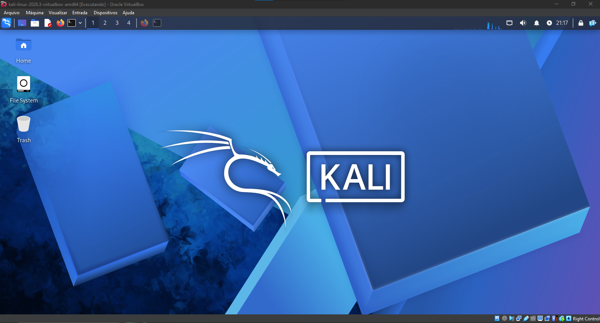
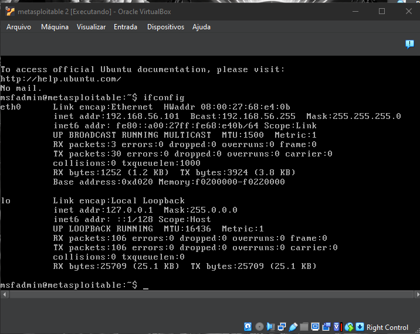
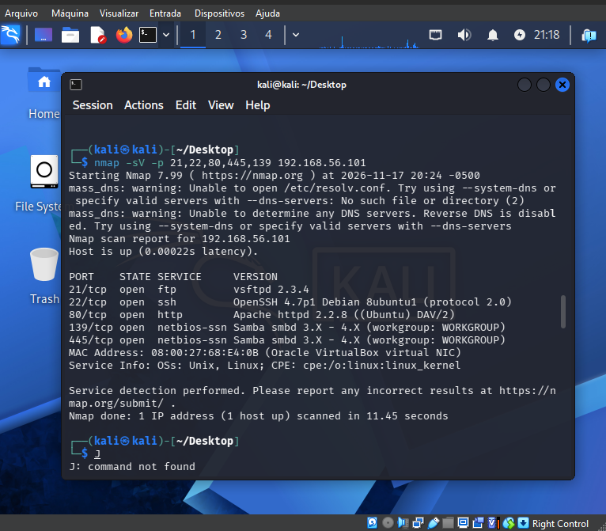
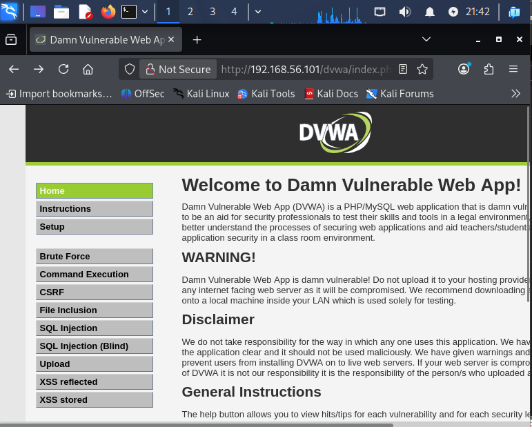

# 🔐 Projeto de Auditoria Medusa

## 📌 Sobre o projeto

Este projeto foi desenvolvido para aprender um pouco mais sobre segurança da informação, principalmente sobre senhas, autenticação e vulnerabilidades.

A ideia é montar um laboratório usando máquinas virtuais, conhecer algumas ferramentas de segurança e entender como elas funcionam na prática.

## 🛠️ Ferramentas utilizadas

- **Kali Linux:** sistema que estou utilizando para realizar os estudos.
- **Medusa:** ferramenta voltada para testes de autenticação.
- **Metasploitable 2:** máquina virtual com vulnerabilidades para praticar.
- **DVWA:** aplicação web utilizada para estudar falhas de segurança.
- **Nmap:** ferramenta para identificar portas e serviços.
- **VirtualBox:** programa utilizado para executar as máquinas virtuais.

- ## 🔐 Medusa

A Medusa foi instalada no Kali Linux. Estou estudando seu funcionamento e sua utilização em auditorias de autenticação em ambientes controlados.

## 💻 Montagem do laboratório

Para começar, configurei duas máquinas virtuais no VirtualBox:

- Kali Linux

- Metasploitable 2

Configurei as duas em uma rede Host-Only para que pudessem se comunicar em um ambiente de laboratório isolado.

## 🔎 Identificação de serviços

Utilizei o Nmap para verificar quais serviços estavam disponíveis no Metasploitable 2.

Os resultados encontrados foram:

| Porta | Serviço |
|---|---|
| 21 | FTP |
| 22 | SSH |
| 80 | HTTP |
| 139 | SMB |
| 445 | SMB |

## 🌐 Acesso ao DVWA

Consegui acessar o DVWA pelo navegador do Kali Linux.

Também explorei o menu da aplicação e encontrei o módulo **Brute Force**, que apresenta uma tela de autenticação com usuário e senha.

Essa etapa ajudou a entender melhor como funciona o processo de login e quais riscos podem existir quando não há proteção adequada.

## 🛡️ O que podemos aprender sobre segurança?

Algumas medidas que ajudam a proteger contas e sistemas:

- Criar senhas fortes.
- Limitar tentativas de login.
- Bloquear temporariamente acessos suspeitos.
- Utilizar autenticação em duas etapas.
- Acompanhar os registros de acesso.

## 📝 Conclusão

Esse projeto está sendo uma oportunidade para aprender mais sobre Linux, redes e segurança da informação.

Durante a montagem do laboratório, consegui configurar as máquinas virtuais, testar a comunicação entre elas, identificar serviços com o Nmap e acessar o DVWA.

Ainda há etapas para explorar e documentar, principalmente relacionadas à ferramenta Medusa e à proteção dos sistemas.

## ⚠️ Aviso

Este laboratório é destinado exclusivamente a estudos em ambientes próprios e autorizados.
